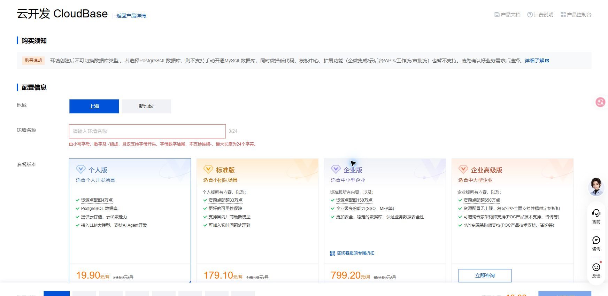
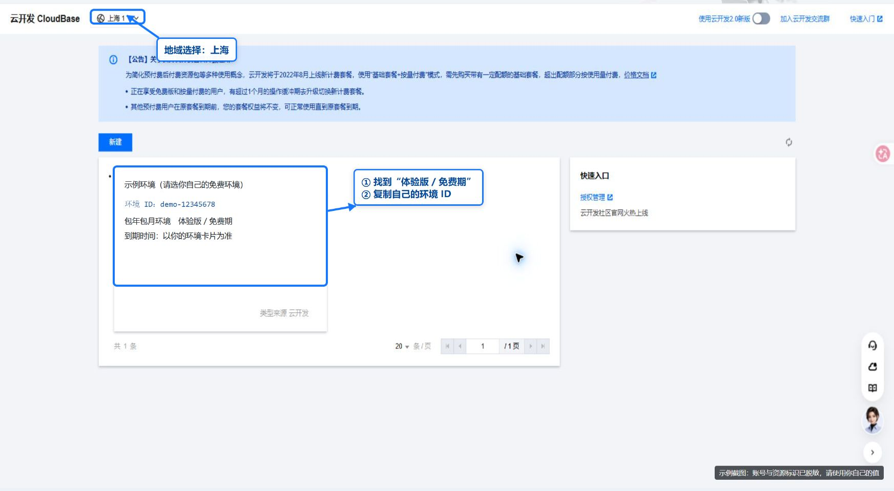

# CloudBase 3.0 免费部署新手图文版

> 文档版本：2026-09-10。适用于毕方 `daily_active` 与 application-version API v1。旧静态更新清单已退出 3.0，不再上传或配置。

## 先看结论

- 不需要购买自己的域名或证书；只用 CloudBase 平台默认 HTTPS 域名。
- 只复用负责人已经确认的一个免费环境，不创建第二环境。
- 页面只有明确显示最终应付 `0 元` 才能继续；任何非零金额、升级、连续包月、自动续费、超限按量、资源包、EdgeOne、自定义域名或证书购买提示都要停止。
- 新手向导不需要账号 SecretId/SecretKey、Token、Cookie、验证码或银行卡信息。
- 多个工具共享环境和额度，但 telemetry、发布流 code、凭据绑定与数据集合必须隔离。
- 所有云端写入或删除都要先完成最新只读预检、展示精确目标，再等待负责人明确“继续”。


截图只是制作时的页面状态，不能保证未来价格或资格。操作当天以环境卡片、额度、到期时间和最终订单为准。免费资格不可用时不要购买替代套餐。

## 看到这个页面就停

旧控制台点“新建”后，账号没有可用免费资格时可能直接进入购买页。下图是非零订单示例；不要填写环境名，不要点“立即购买”。



## 3.0 要部署什么

以 `bifang-screen-recorder` 为例：

| 类型           | 示例                                    | 控制台位置           |
| -------------- | --------------------------------------- | -------------------- |
| 环境           | 复用现有免费环境                        | 环境列表             |
| Telemetry 函数 | `telemetry-bifang-screen-recorder`      | 云函数               |
| Telemetry 路由 | `/apps/bifang-screen-recorder/v1/track` | HTTP 网关            |
| Telemetry 集合 | `telemetry_bifang_screen_recorder`      | 文档型数据库         |
| Version 函数   | `application-version-api`               | 云函数               |
| Version 路由   | `/tools/version-control/v1`             | HTTP 网关            |
| Version 集合   | `versions_bifang_screen_recorder`       | 文档型数据库         |
| Ads 集合       | `ads_bifang_screen_recorder`            | 文档型数据库         |
| Audit 集合     | `audit_bifang_screen_recorder`          | 文档型数据库         |
| 默认域名       | `*.app.tcloudbase.com`                  | HTTP 网关 → 默认域名 |

录屏助手发布流：

```text
bifang-screen-recorder-windows-x64
bifang-screen-recorder-macos-arm64
```

鼠标精灵稳定流：

```text
bifang-mouse-clicker
```

Version 请求没有平台字段，所以 Windows/macOS 不能共用一个 code，也不能靠 User-Agent 猜测。

## 第一步：只读确认环境

### 1. 打开控制台

优先打开 [CloudBase 开发平台](https://tcb.cloud.tencent.com/dev)。如果只显示扫码页，可从 [腾讯云 CloudBase 控制台](https://console.cloud.tencent.com/tcb) 进入已有环境，再点“前往新版开发平台”。

### 2. 选择已有免费环境

```text
腾讯云控制台 → 云开发 CloudBase → 环境列表
```



核对并记录：

- 环境 ID；
- 套餐/免费状态；
- 到期时间；
- 是否开启超限按量或自动续费；
- 当前函数、数据库、网关和存储余量。

没有已确认免费环境时停止，不自行创建或购买。

### 3. 确认平台默认 HTTPS 域名

```text
CloudBase 开发平台 → HTTP 网关 → 默认域名
```

在“默认域名”页确认域名已经启用且证书状态正常；不要按历史截图中的路由名称操作。只记录 `https://...app.tcloudbase.com` origin，不带 path、query、fragment、账号或密码。Version Base URL 由工具确定性拼接：

```text
https://<平台默认域名>/tools/version-control/v1
```

不要再拼第二个 `/v1`。

## 第二步：本地准备与计划

从仓库根目录：

```powershell
npm ci
npm run cloudbase:config:check
npm run check
```

`cloudbase/apps.json` 是 APP_ID 与发布流的唯一非敏感权威。生成配置必须同时包含所有登记 telemetry、共享 version service 与看板，且不得含静态更新 hosting 或旧版本路由。

Version service 需要两份被 Git 忽略的本地输入：

- `cloudbase/application-version-credentials.b64`：Git 忽略的摘要凭据配置 Base64；
- `cloudbase/application-version-live-state.json`：当前远端只读实况与费用门禁。

首次使用时，在 Windows 执行以下命令生成摘要配置；Key/Secret 原值由当前用户 DPAPI 加密保存在 `%LOCALAPPDATA%\Bifang\OperationsAssistant\`，不会写进仓库：

```powershell
powershell -NoProfile -ExecutionPolicy Bypass -File tools/application-version-credentials.ps1 -Mode generate
```

它们不得提交、打印或复制进证据。先生成无写步骤计划：

```powershell
npm run cloudbase:version-api:deploy:plan -- --env-id <环境ID> --origin https://<默认域名> --credentials-b64-file cloudbase/application-version-credentials.b64
```

没有完整 live-state 时，计划必须显示 `live-state-required` 且写步骤为空。补齐只读实况后再运行：

```powershell
npm run cloudbase:version-api:deploy:plan -- --env-id <环境ID> --origin https://<默认域名> --credentials-b64-file cloudbase/application-version-credentials.b64 --live-state-file cloudbase/application-version-live-state.json
```

输出只允许显示 credential ID、APP_ID、codes、scopes、Secret 版本数和配置/部署材料 SHA-256；不得显示 Key、Secret 或其摘要。每份客户端运行凭据只绑定一个 code 且只有 `versions:check`；每条发布流必须具备客户端运行、独立的 `versions:read + ads:read`、独立的 `versions:write + ads:write` 覆盖；全局还必须恰好有一份不可导出的 `contract-ads-*` 凭据用于 `ads:show` 契约测试。不同角色的 scope 不得混用。

## 第三步：核对数据库

```text
CloudBase 开发平台 → 文档型数据库 → 集合管理
```

如果计划要求创建缺失集合，名称必须与派生结果完全一致，权限选择 `ADMINONLY`。控制台中不要照历史截图抄写 `telemetry_events` 等旧示例名；只使用本次只读计划列出的逐应用集合名。

不要覆盖现有非空集合，不把一个应用的 code/data 写入另一个应用集合。已有集合 ACL、索引或数据与目标冲突时停止。

## 第四步：核对函数

```text
CloudBase 开发平台 → 云函数 / 托管 → 函数管理
```

Telemetry 函数每个只允许自己的 APP_ID、集合与路由。Version 函数共享，但配置把每个 APP_ID 固定映射到自己的三类集合；凭据 binding 固定 APP_ID、codes 和 scopes。不要照历史截图恢复 `telemetry` 或 `example-tool` 示例配置；部署计划还要核对当前函数名、运行时、handler、timeout、memory 和环境变量总字节。负责人确认后只能执行计划列出的 credential-bound helper：它复核凭据、tracked 配置和函数源码的部署材料 SHA-256，只用仓库内固定的 `@cloudbase/cli@3.8.1` 与 `process.execPath` 启动，不信任 PATH 中的 `tcb`，并把凭据只注入固定函数子进程；不允许手工复用另一份环境变量。

## 第五步：写入前确认

向负责人展示：

1. 现有环境 ID、默认域名和零费用证据；
2. 要创建/更新/保留的每个函数、路由、集合、ACL 和索引；
3. APP_ID、三条发布流 code 与凭据 scope 摘要；
4. 不会改动的 telemetry、看板和其他应用；
5. 失败回滚方式；
6. 写入步骤中无顶层 deploy、`--all`、`--prune` 或删除命令；`--force` 只能由 credential-bound helper 用于固定的 `tcb fn deploy application-version-api` 精确创建或更新，不得用于通配、目录推断或批量目标。

等待负责人明确“继续”后，才执行审查过的精确步骤。失败后重新读取状态，不自动重试有副作用操作。

## 第六步：公网 HTTP E2E

服务端必须真实验证：

- Version check 的无更新、提示、强制、停止；
- Ads 的空数组与单条安全内容；
- 八个管理端点的读取/写入/详情/列表；
- 两个认证头、scope、跨 APP/code 拒绝；
- 400/401/403/404/409/429/500；
- 数字点分版本比较、内容消毒、事务与审计；
- `/v1/v1` 固定 404。

本地 mock、localhost、单元测试和旧部署回执不能替代本次公网证据。

## 第七步：两个真实客户端

在鼠标精灵和录屏助手各自 Task 中完成客户端接入与本地测试；阶段 6 再构建安装。真实 E2E 记录准确制品版本、SHA-256、路径、进程、窗口、最终请求 URL 和遮挡凭据后的认证头存在性。

两者都要证明不再请求旧静态版本协议。录屏助手 Windows 与 macOS 分别使用自己的 code；没有真实 Mac 时 macOS 保持 `Unverified`。

## 第八步：旧线上静态资源退役

只有新服务与两个 Windows 客户端 E2E 完成后，才重新完整枚举旧路由和对象。计划逐项列出候选，不生成删除命令、不使用通配符或目录级删除。未知对象先确认归属；telemetry、version service、看板和其他应用绝不进入退役范围。

展示精确删除目标、当前元数据/哈希、为何可删和恢复材料，再等待负责人另一次明确“继续”。删除后验证新 API、两个 telemetry 路由和看板仍正常，旧精确对象返回 404。

## 出错时只保留这些非敏感信息

- 操作时间和时区；
- 环境 ID、函数/路由/集合名称；
- HTTP 状态和脱敏错误码；
- 本地 Git 提交、测试命令和退出码；
- 不含 Key/Secret/Token/IP 的截图。

不要把 Cookie、Authorization、SecretId、SecretKey、Key/Secret 原值、数据库记录个人信息或完整环境导出贴入聊天、Git 或回执。
