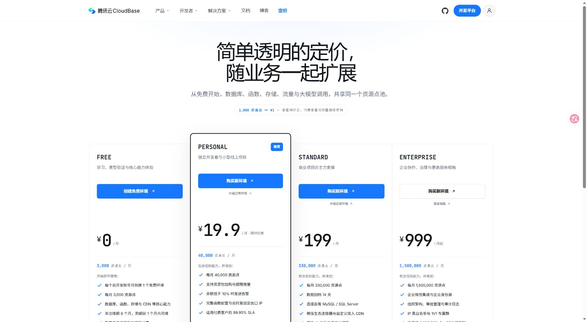
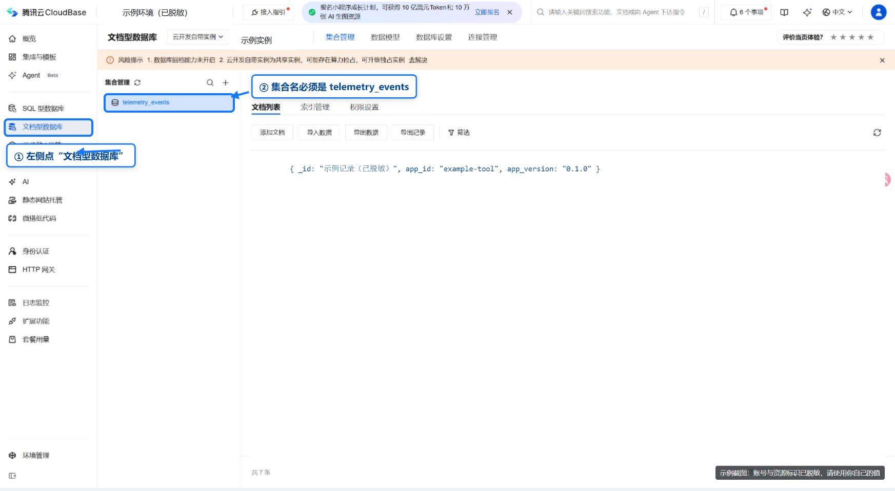
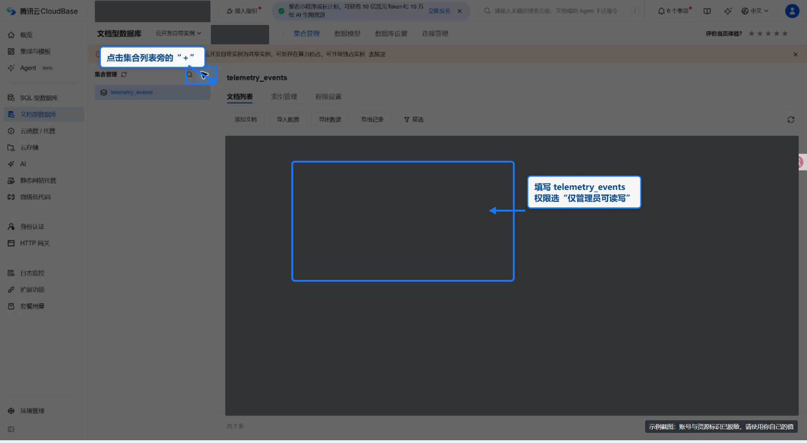
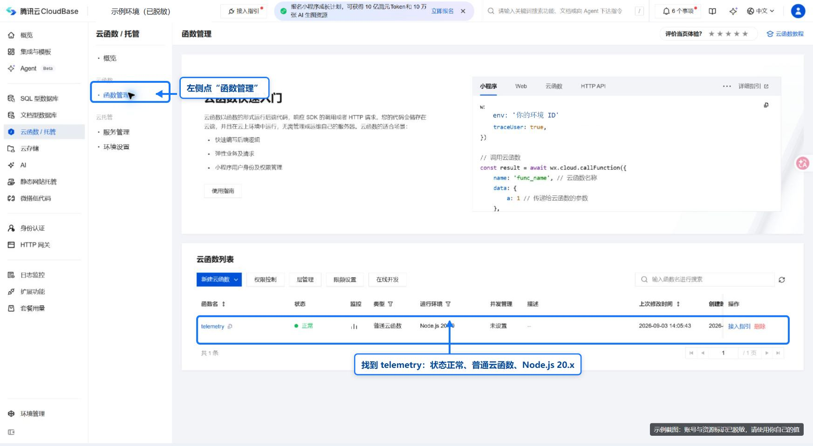
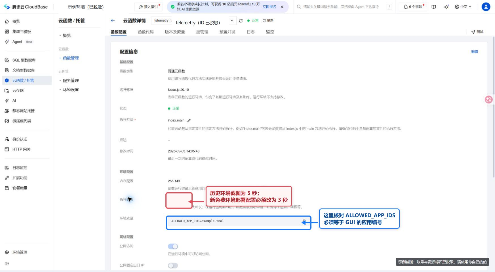
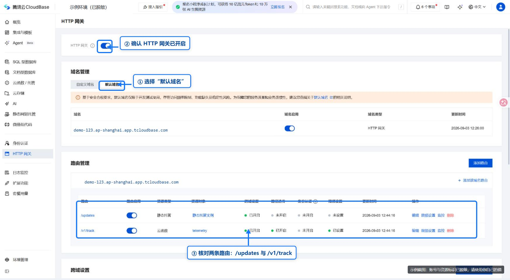
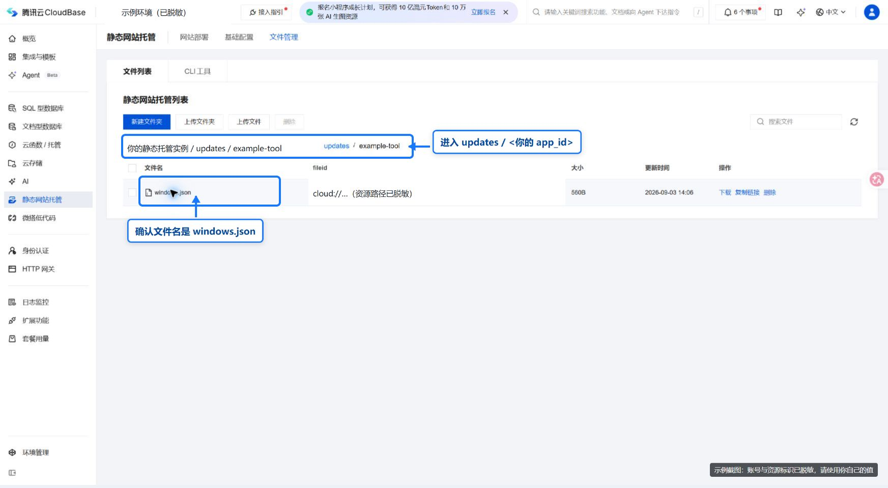

# CloudBase 免费资源优先部署：新手图文版

> 文档版本：2026-09-05。适用于本项目的 Windows 小白验证向导。控制台名称以后可能微调，但资源名称和核对原则不变。

## 先看结论

- **不需要购买自己的域名。** 开发、演示和小伙伴内部验收直接使用 CloudBase 的系统默认域名。
- **必须填写 HTTPS 地址。** HTTPS 不需要另买证书；CloudBase 默认域名已经自带 HTTPS。
- **只使用账号当前可用的免费环境和平台默认资源。** 本教程不会新增付费服务，但平台套餐、额度和价格以后可能变化，必须以操作当天控制台为准。
- **只按“最终应付 0 元”判断是否继续。** 页面写 `FREE`、`免费体验版`、`体验版`，或明确写免费期且最终应付为 `0 元`，才可以继续；任何非零订单都要停止并先告知负责人。
- **不要开启任何收费项。** 看见非零金额、连续包月、自动续费、超限按量、资源包、EdgeOne 或自定义域名购买，立即停止。
- **小白向导不需要账号密钥。** 不要向向导填写 SecretId、SecretKey、Token、Cookie、验证码或银行卡信息。
- **多个工具可以共用一个免费环境，但不能共用业务资源。** 每个工具都有独立函数、路由、数据库集合、本地状态目录和更新文件；只共享默认域名与免费额度。



官方入口：[CloudBase 套餐与资源点](https://cloud.tencent.com/document/product/876/127357)。截图只是制作文档时的页面状态，不能保证未来价格或资格。部署和验证仍会消耗数据库、云函数、HTTP 网关、静态存储及流量额度；以环境卡片显示的额度、到期时间和最终订单为准。若免费资格不可用，不要购买替代套餐，先告知负责人。

## 第一期到底统计什么

- 统计的是软件**启动使用**，不是安装。安装但从未启动不计数。
- 同一个匿名 `install_id` 按北京时间（`Asia/Shanghai`）每天第一次启动最多上报一次固定事件 `daily_active`。
- 不统计渠道、功能点击、任务开始/成功/失败、更新提示或更新点击。
- 客户端提供匿名设备标识、系统平台/架构、应用编号和版本；服务端补上日期、接收时间和来源 IP。
- 当天启动设备数可以近似观察“每天有多少人在用”，但不是账号人数：同一人多台设备会多计，重装或清除本地标记也可能产生新设备。
- IP 不能用来去重人数。同一家庭/公司常共用公网 IP，移动网络 IP 也会变化。

为保护免费网关，客户端在联网前先把当天标记写入本地。即使本次发送失败，当天也不会重试；这里有意接受偶发少计，避免用户反复启动产生高频请求。测试程序模拟 10 台设备时最多发送 10 次 POST；因为都从同一电脑发出，数据库里通常会看到相同公网 IP。

`source_ip` 属于个人信息。正式接入前必须向用户说明统计目的，设置满足目的所需的最短保留期限；对外分享数据库截图、日志或导出文件前必须遮挡 IP。不要采集主机名、MAC、硬盘号、账号名或用户输入内容。

### 看到这个页面就停

旧控制台点“新建”后，账号没有可用免费资格时可能直接进入购买页。下图是制作文档时出现的非零订单示例；页面还可能默认选择“连续包月”和“超限按量”。不要填写环境名，不要点“立即购买”。即使页面写免费期，也必须继续核对最终应付是否为 `0 元`。


## 你最终要准备好的内容

以下示例使用 `app_id=bifang-tools`。每增加一个工具，就按同一规则增加一整行独立资源；不要把新工具继续命名为 `bifang-tools`。

| 内容            | `bifang-tools` 示例                                      | 所在页面                       |
| --------------- | -------------------------------------------------------- | ------------------------------ |
| CloudBase 环境  | 复用已有免费体验环境                                     | 环境列表 / 左上角环境选择器    |
| 环境 ID         | 每个环境不同，本流程只填入 CLI                           | 环境列表或环境总览             |
| 数据库集合      | `telemetry_bifang_tools`                                 | 文档型数据库 → 集合管理        |
| 云函数          | `telemetry-bifang-tools`，普通云函数                     | 云函数 / 托管 → 函数管理       |
| 函数环境变量    | 下文列出的三个变量，每个函数只服务一个工具               | 目标函数 → 函数配置 → 环境变量 |
| 数据接收路由    | `/apps/bifang-tools/v1/track` → `telemetry-bifang-tools` | HTTP 网关 → 路由管理           |
| 更新路由        | `/updates` → 静态托管                                    | HTTP 网关 → 路由管理           |
| 更新文件        | `updates/bifang-tools/windows.json`                      | 静态网站托管 → 文件管理        |
| 平台 HTTPS 域名 | `*.app.tcloudbase.com`                                   | HTTP 网关 → 默认域名           |

派生规则固定为：函数名 `telemetry-<app_id>`；集合名 `telemetry_` 加上把 `app_id` 中每个短横线替换为下划线后的结果；数据路由 `/apps/<app_id>/v1/track`；更新文件 `updates/<app_id>/<platform>.json`。例如 `bifang-tools-pdf` 的集合是 `telemetry_bifang_tools_pdf`。完整说明见[多工具隔离指南](multi-tool-isolation.md)。

---

# 第一步：完成云端准备

## 1. 打开正确的控制台

优先打开：[CloudBase 开发平台](https://tcb.cloud.tencent.com/dev)。

如果 Edge 只显示 QQ 扫码页，但腾讯云控制台已经登录，可以这样进入：

1. 打开[腾讯云 CloudBase 控制台](https://console.cloud.tencent.com/tcb)。
2. 在环境列表中点击自己的环境。
3. 点击“使用云开发 2.0 新版”“前往新版开发平台”或“立即前往”。
4. 新版左侧菜单应能看到“文档型数据库”“云函数 / 托管”“静态网站托管”和“HTTP 网关”。

> 2026 年 6 月起，官方把旧名称“HTTP 访问服务”改为“HTTP 网关”。旧文档或旧控制台仍可能显示旧名称，它们指的是同一类入口。

## 2. 选择或创建免费环境，并复制环境 ID

页面路径：

```text
腾讯云控制台 → 云开发 CloudBase → 环境列表
```

### 已经有体验环境

1. 环境卡片上确认套餐仍处在免费状态，且没有超限按量或自动续费。
2. 点击环境名称进入环境。
3. 复制“环境 ID”；不要把环境显示名称当成环境 ID。
4. 本项目需要文档型数据库，因此地域必须使用上海。新加坡当前只提供 PostgreSQL，不适合这套独立文档集合方案。


截图已经脱敏。小伙伴照做时必须复制自己账号中的环境 ID，不能照抄示例值。

### 第一次使用，还没有环境

1. 打开[CloudBase 官方价格页](https://tcb.cloud.tencent.com/pricing)，找到 `FREE`，再进入免费环境创建页。
2. 首次使用若提示“服务角色授权”，按腾讯云官方流程授权；这是让 CloudBase 管理本账号云资源，不是购买套餐。
3. 若尚未完成实名认证，先在腾讯云官方账号中心完成。静态网站托管把实名认证列为前置条件；实名资料只填在腾讯云官方页面，不要填进本项目 GUI，也不要发给他人。
4. 创建时选择：`上海` → `云数据库 / 文档型数据库`。上海还可能出现 PostgreSQL，必须明确选文档型数据库；数据库类型创建后不能随意切换。
5. 提交前再次确认最终应付 `0 元`，没有开启按量超限或自动续费；任何可能收费的变化都要先告知负责人。
6. 如果只剩普通个人版、出现任何非零价格，或没有免费入口，立即停止。常见原因是账号已有免费环境或以前的免费资格仍在占用。

官方静态托管要求实名认证，但官方 CloudBase 文档没有把“绑定银行卡”列为领取免费环境的固定前置条件。如果实际页面要求绑卡、充值或付款，不要继续，先让负责人核对。

官方说明：[创建与选择环境](https://docs.cloudbase.net/quick-start/create-env)、[静态托管快速开始](https://docs.cloudbase.net/hosting/quick-start)。

## 3. 建立文档数据库集合

新版页面路径：

```text
左侧菜单 → 文档型数据库 → 集合管理
```

先确定这个工具唯一的 `app_id`。基础设施编号必须只含小写字母、数字和短横线，最长 50 个字符，并以小写字母或数字开头和结尾。`bifang-tools` 对应集合 `telemetry_bifang_tools`。

已有该工具独立集合时不要重复创建。没有时：

1. 点击集合列表旁边的“+”或“新建集合”。
2. 集合名称准确填写 `telemetry_<规范化app_id>`；规范化只把每个短横线 `-` 替换为下划线 `_`。
3. 权限选择“仅管理员可读写”或平台中含义相同的管理员/云函数专用选项。
4. 不要选择“所有用户可读写”。
5. 点击确定后，应在左侧集合列表中看到该工具自己的集合，例如 `telemetry_bifang_tools`。

仓库生成器不会自动创建数据库集合，这一步必须在 CloudBase 数据库页面手工完成。只生成 `cloudbaserc.json.example` 或部署函数并不能代替建集合。



> 截图中的 `telemetry_events` 和已有记录来自历史验收，只用于定位集合页面。新方案不要继续共用它；`bifang-tools` 应写入 `telemetry_bifang_tools`，其他工具写入各自集合。



官方说明：[文档型数据库控制台](https://cloud.tencent.com/document/product/876/46897)。

## 4. 在本机准备部署参数

电脑需要免费的 Node.js 20+ 和 Python 3.9+。在项目根目录打开 PowerShell，先安装依赖并检查项目：

```powershell
npm ci
npm run check
```

安装并登录官方 CloudBase CLI：

```powershell
npm install --global @cloudbase/cli@3.8.1
tcb login
```

`@cloudbase/cli@3.8.1` 是本仓库实测固定版本，不代表官方最新版本。

登录只在腾讯云官方页面完成。不要把验证码、Cookie、Token、SecretId 或 SecretKey 发给任何人。

如果要新增工具，先用安全命令登记。例如：

```powershell
npm run cloudbase:app:add -- bifang-tools-pdf
```

它会拒绝重复或非法编号，自动创建默认关闭的占位更新清单，并重生成同时包含所有工具的部署模板。已有 `bifang-tools` 时不要重复执行。随后检查并生成本机配置：

```powershell
npm run cloudbase:config:check
Copy-Item -LiteralPath .\cloudbaserc.json.example -Destination .\cloudbaserc.json
$env:ENV_ID = "<刚才复制的环境ID>"
```

`app_id` 是软件的短英文编号，不是 CloudBase 自动生成的。本仓库第一个示例是 `bifang-tools`；每个新工具必须另取唯一编号。登记表在 `cloudbase/apps.json`，但优先使用上面的追加命令，不要手工维护生成后的函数和路由列表。生成后的一个模板会同时保留全部工具函数和路由，避免部署新工具时漏掉旧资源。

规则：只用小写字母、数字和短横线，最长 50 个字符，并以小写字母或数字开头和结尾。GUI、独立函数配置、路由、集合派生名和更新文件中的 `app_id` 必须完全一致。

### 部署前按当前免费环境允许值核对超时

当前生成模板中每个工具函数的超时均为 3 秒，以适配制作本文档时的免费体验环境。运行任何 `validate` 或 `deploy` 命令之前，仍需在控制台核对当天的免费规格，并确认每个 `telemetry-<app_id>` 项都是：

```json
"timeout": 3
```

若免费规格不接受这个值，停止并先告知负责人，不要为了增加超时购买套餐，不要改成 Web 函数，也不要开启付费服务。平台规格可能变化，依据操作当天的 [CloudBase 套餐与资源点](https://cloud.tencent.com/document/product/876/127357)。

## 5. 先预检，再部署

按顺序执行：

```powershell
tcb validate
tcb deploy --dry-run
tcb deploy
```

- `validate`：只检查配置，不修改云端。
- `deploy --dry-run`：只预览变化，不修改云端。
- `deploy`：前两步确认无误后才真正写入 CloudBase。

在 dry-run 中应看到登记表内所有工具的独立函数和独立 `/apps/<app_id>/v1/track` 路由，以及共享的 `updates` 静态托管路由。若出现删除已有工具资源、购买套餐、按量付费或不认识的资源，停止部署。

新增、改名或删除应用都要在 dry-run 中检查旧函数、旧路由、集合和孤儿更新目录；`cloudbase/apps.json` 不会替你自动清理云端。迁移历史 `/v1/track` 时，先保留旧资源，部署并验证新资源，再切换客户端；观察迁移期后才由负责人确认并人工下线旧资源。不要先删旧路由，否则旧客户端会 404；迁移期若新旧集合同时收数，报表必须注明统计范围。

> 重要：历史示例环境里部署的是旧 v1 多事件协议。要测试本版 `daily_active`，必须先把当前仓库的新版云函数部署成功，再运行新版测试程序；旧云函数会拒绝新版请求。

部署模板随项目提供，文件名为 `cloudbaserc.json.example`。

## 6. 去三个部署结果页核对

文档数据库已在第 3 节核对。部署完成后，再检查下面三个页面。

### 6.1 云函数

路径：

```text
左侧菜单 → 云函数 / 托管 → 函数管理
```

应看到：

- 函数名 `telemetry-<app_id>`，例如 `telemetry-bifang-tools`；
- 状态“正常”；
- 类型“普通云函数”；
- 运行环境 Node.js 20.x。



点击目标工具的函数 → “函数配置”，再核对：

- 执行方法为 `index.main`；
- `ALLOWED_APP_IDS=<该函数唯一的 app_id>`，不能填多个工具；
- `TELEMETRY_COLLECTION=telemetry_<规范化app_id>`；
- `TRACK_PATH=/apps/<app_id>/v1/track`。



> 截图来自历史体验环境，只用于定位设置区域。画面中的 `telemetry` 函数、旧应用编号和旧变量数量都不要照抄。新方案中 `bifang-tools` 使用 `telemetry-bifang-tools`，三个变量分别为 `bifang-tools`、`telemetry_bifang_tools` 和 `/apps/bifang-tools/v1/track`。画面中的 5 秒也是历史值；当前生成模板已经使用 3 秒。

不要点“编辑”修改其他网络、VPC 或固定出口 IP。官方说明：[云函数控制台](https://cloud.tencent.com/document/product/876/46899)。

### 6.2 HTTP 网关、默认域名与路由

路径：

```text
左侧菜单 → HTTP 网关 → 域名管理 → 默认域名
```

先确认页面顶部的“HTTP 网关”开关已开启，再选择“默认域名”。应看到一个以 `.app.tcloudbase.com` 结尾的 HTTP 网关默认域名。不要误用静态托管的 `*.tcloudbaseapp.com` 地址。下方“路由管理”应有：

| 路由                          | 资源类型 | 资源对象                 |
| ----------------------------- | -------- | ------------------------ |
| `/apps/bifang-tools/v1/track` | 云函数   | `telemetry-bifang-tools` |
| `/updates`                    | 静态托管 | 静态托管实例             |



默认域名已经支持 HTTPS，不需要购买域名或证书，适合本阶段开发、演示和内部验收。自定义域名、EdgeOne、证书购买或套餐升级都不属于本教程；如果以后平台提示这些功能需要付费，必须先告知负责人并停止。平台能力和价格可能变化，以操作当天为准。官方说明：[HTTP 网关](https://docs.cloudbase.net/service/introduce)、[访问云函数](https://docs.cloudbase.net/service/access-cloud-function)、[套餐与配额](https://cloud.tencent.com/document/product/876/127357)。

### 6.3 静态托管更新文件

路径：

```text
左侧菜单 → 静态网站托管 → 文件管理 → updates → <你的 app_id>
```

应看到 `windows.json`。如果 `app_id` 是 `bifang-tools`，完整云端路径为：

```text
updates/bifang-tools/windows.json
```



> 截图中的目录名属于历史验收，只用于定位文件管理页面。本次必须上传到 `updates/bifang-tools/windows.json`。

本地示例随项目提供，路径是 `cloudbase/updates/bifang-tools/windows.json`。官方说明：[静态托管文件管理](https://docs.cloudbase.net/hosting/manage)。

### `windows.json` 14 个字段怎么看

完整填写规则见 [`cloudbase/updates/WINDOWS_JSON_FIELDS.zh-CN.md`](../cloudbase/updates/WINDOWS_JSON_FIELDS.zh-CN.md)。14 个字段的中文含义如下：

| 字段                    | 中文说明                                                   |
| ----------------------- | ---------------------------------------------------------- |
| `schema_version`        | 清单协议版本，当前固定为整数 `1`                           |
| `app_id`                | 应用编号，必须与客户端、独立函数、路由和目录名完全一致     |
| `platform`              | 适用平台，Windows 文件填写 `windows`                       |
| `latest_version`        | 准备发布的最新完整 SemVer 版本                             |
| `min_supported_version` | 仍允许继续使用的最低版本，低于它会判为必须更新             |
| `enabled`               | 是否启用此更新清单                                         |
| `force_update`          | 是否把低于最新版的客户端都判为必须更新                     |
| `rollout`               | 可选更新覆盖比例，填写 `0` 到 `100` 的整数                 |
| `title`                 | 显示给用户的纯文本标题                                     |
| `message`               | 显示给用户的纯文本正文                                     |
| `download_url`          | 安装包真实公网 HTTPS 地址；`.example.invalid` 绝不能上线   |
| `release_notes_url`     | 版本说明真实公网 HTTPS 地址；`.example.invalid` 绝不能上线 |
| `sha256`                | 安装包真实 SHA-256；空字符串只能用于占位测试               |
| `published_at`          | 带时区的严格 RFC3339 发布时间                              |

`windows.json` 必须保持严格 JSON，JSON 本身不能写注释，也不能增加 `_说明`、`comment` 等说明键。中文解释放在上面的独立说明文档中；所有 14 个字段的 Schema 也已带中文 `description`。

---

# 第二步：填写你的 CloudBase 信息

打开本项目的小白验证向导：

```powershell
npm run build --workspace @bifang/telemetry-update-sdk
python .\tools\python-sdk-test-client\gui.py
```

如果系统找不到 `python`，改用：

```powershell
py -3 .\tools\python-sdk-test-client\gui.py
```

GUI 中只需要填写四项：

| GUI 字段     | 去哪里找                                                | 正确格式                                                   | 不要填什么                        |
| ------------ | ------------------------------------------------------- | ---------------------------------------------------------- | --------------------------------- |
| 应用编号     | 目标工具函数 → 函数配置，核对其唯一 `ALLOWED_APP_IDS`   | `bifang-tools`                                             | 其他工具编号、环境 ID、软件中文名 |
| 当前版本     | 来自当前正在验证的软件，不来自 CloudBase                | 完整三段版本，如 `0.1.0`                                   | `v0.1`、日期、最新云端版本        |
| 数据接收地址 | `HTTP 网关 → 默认域名`，再拼 `/apps/<app_id>/v1/track`  | `https://<网关默认域名>/apps/bifang-tools/v1/track`        | 共享旧 `/v1/track`、其他工具路由  |
| 更新文件地址 | 同一网关默认域名，再拼 `/updates/<app_id>/windows.json` | `https://<网关默认域名>/updates/bifang-tools/windows.json` | 其他工具文件、`cloud://` 地址     |

## 地址怎么拼

假设“HTTP 网关 → 默认域名”显示：

```text
demo-123.ap-shanghai.app.tcloudbase.com
```

且 `app_id` 是 `bifang-tools`，则填写：

```text
数据接收地址：
https://demo-123.ap-shanghai.app.tcloudbase.com/apps/bifang-tools/v1/track

更新文件地址：
https://demo-123.ap-shanghai.app.tcloudbase.com/updates/bifang-tools/windows.json
```

逐字检查：

1. 两个地址都必须以 `https://` 开头。
2. 数据接收地址必须以 `/apps/<同一个 app_id>/v1/track` 结尾；不要使用历史共享 `/v1/track`。
3. 更新地址必须以 `/updates/<同一个 app_id>/windows.json` 结尾。
4. 数据地址和更新地址中的 `app_id` 必须与第一项完全一致，不能串到另一个工具。
5. 不要多写一层 `/updates/updates/`。
6. 不要照抄本文截图中的环境 ID 或域名。

更新文件地址可以先在 Edge 中打开。默认域名可能直接显示 JSON、下载 JSON，也可能先出现腾讯云安全提示页，这些都不一定是错误。最终以 GUI “检查有没有新版本”成功，或下面命令返回 `200` 且内容是目标 JSON 为准：

```powershell
curl.exe -i "https://<网关默认域名>/updates/<你的app_id>/windows.json"
```

显示 404 时，回到“静态网站托管 → 文件管理”检查目录名和 `app_id`。

Telemetry 地址只接收 POST。直接在浏览器打开它看到 405 或“不允许此方法”通常是正常现象，不代表部署失败。

## 环境 ID 到底填在哪里

环境 ID **不填进 GUI**，只填在部署 PowerShell 的：

```powershell
$env:ENV_ID = "<环境ID>"
```

GUI 不需要、也不应保存 SecretId、SecretKey、Token、Cookie 或腾讯云登录密码。

## “载入本项目示例”按钮的边界

该按钮会填入项目的演示 `app_id`、版本和历史 smoke 地址，但点击按钮本身不联网。之后点击“发送”或“检查更新”才会访问这些地址。

要验证自己的环境，载入示例后必须把两个 URL 换成自己的默认域名。按钮里的域名来自历史 smoke 环境，新拼出的独立路由不代表已经在线部署，不能把它当成长期业务环境。

---

# 第三步：最短验收

1. GUI 中确认四项无误。
2. 点击“发送 1 条启动使用测试到 CloudBase”，在确认框中再次检查目标域名。它只发送固定的 `daily_active`，不发送安装、渠道、功能、任务或更新交互事件。
3. 成功后点击“复制本次测试查询条件”。
4. 回到 `文档型数据库 → 集合管理 → telemetry_<目标工具规范化app_id> → 文档列表 → 筛选`；例如 `bifang-tools` 使用 `telemetry_bifang_tools`。
5. 粘贴筛选条件；能查到本次新记录，才算端到端成功。
6. 再点击“检查有没有新版本”，确认能读取 `windows.json`。

数据库中的新版记录应包含：

| 字段                     | 谁提供             | 说明                                                  |
| ------------------------ | ------------------ | ----------------------------------------------------- |
| `event`                  | 客户端固定值       | 始终为 `daily_active`，表示当天首次启动使用，不是安装 |
| `app_id` / `app_version` | 客户端             | 应用编号和当前版本                                    |
| `install_id`             | 客户端本地匿名标识 | 用于区分当天启动设备；不是账号、主机名或硬件号        |
| `platform` / `arch`      | 客户端             | 操作系统平台和 CPU 架构                               |
| `active_date`            | 服务端             | 按 `Asia/Shanghai` 计算的日期                         |
| `received_at`            | 服务端             | 云函数实际接收时间                                    |
| `source_ip`              | 服务端可信上下文   | 来源 IP；取不到时可为 `null`，不能用于人数去重        |

同一 `install_id` 当天重复启动，客户端不会再次 POST；即使请求被重放，服务端也只保存一份。次日第一次启动才会产生当天的新记录。点击“模拟 10 台设备”时最多 10 个 POST/10 条设备记录；从同一测试电脑发送时，它们的 `source_ip` 通常相同，这是正常的。

更完整的 GUI 使用说明随项目提供，路径是 `tools/python-sdk-test-client/README.md`。

## 免费使用的五条红线

| 页面出现什么                             | 怎么做                   |
| ---------------------------------------- | ------------------------ |
| 金额大于 `0.00 元`                       | 停止，不付款             |
| 普通个人版、标准版、企业版或任何非零订单 | 停止，返回已有免费环境   |
| “连续包月 / 自动续费”                    | 不选择，不提交           |
| “超限按量 / 资源包 / 余额扣费”           | 不开启                   |
| “添加自定义域名 / EdgeOne / 购买证书”    | 当前轻量方案不需要，停止 |

免费期只有在最终应付 `0 元`、未开按量和自动续费时才可继续。自定义域名涉及备案、证书和 DNS，EdgeOne 也可能产生费用；本方案都不启用。平台价格和免费配额以后可能变化，任何需要付费的提示都必须先告知负责人，不能顺手开启。官方说明：[自定义域名](https://docs.cloudbase.net/service/custom-domain)、[套餐与配额](https://cloud.tencent.com/document/product/876/127357)、[套餐超限规则](https://cloud.tencent.com/document/product/876/136006)。

## 出错时只保留这些信息

可以截图或复制：

- `tcb validate` / `tcb deploy --dry-run` 的错误文字；
- GUI 的普通错误提示；
- 函数名、路由路径，以及环境 ID / 默认域名的末 4 位（其余用 `***` 遮住）。

不要截图或发送：

- 登录二维码、验证码、Cookie；
- SecretId、SecretKey、Token；
- 完整环境 ID、默认域名、数据库/函数/存储实例 ID；
- 银行卡、账单、实名资料；
- 浏览器保存的密码。

项目目录中的 `docs/cloudbase-deployment.md` 是历史示例环境的部署回执，只用于理解示例，不能把其中的环境 ID 和 URL 当成自己的配置，也不要把未脱敏的回执直接对外分享。
