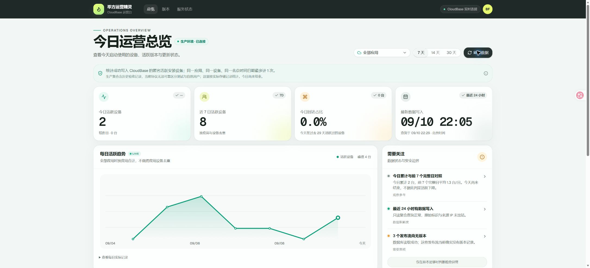

# 运营看板与两款真实客户端 telemetry E2E（2026-09-10）

## 结论

2026-09-10（北京时间）完成了录屏助手和鼠标精灵的 Windows x64 真实客户端启动、生产 telemetry 写入、同日重启去重以及 Edge 生产看板复核。最终生产集合中两款应用各有 1 个当天匿名安装日，看板显示“今日活跃设备 2”。

本回执只证明匿名 `daily_active` 链路和看板聚合结果，不把构建、单元测试或 application-version API 四态测试冒充 telemetry E2E。它也不包含完整匿名安装标识、事件标识、来源 IP、凭据或原始诊断日志。

## 原问题与修正

首次检查时，两款应用 2026-09-10 的生产 telemetry 原始记录均为 0。此前完成的是 application-version API v1 的更新检查 E2E，并没有完成两款客户端的 `daily_active` 落库 E2E。

根因是线上两个 telemetry 函数仍只接受 SDK `2.0.0`，而升级后的两款客户端发送 SDK `3.0.0`。请求在写入前被判为 `400 invalid_payload`；客户端又按合同在联网前落盘当天门禁，因此当天后续普通重启不会重试。

在已有的服务部署授权内，以下两个既有函数被精确更新到当前 `3.0.0` 源码；路由、集合与环境未更名，也没有新增第二个 CloudBase 环境：

| 应用     | 函数                               | 部署后修改时间（北京时间） |
| -------- | ---------------------------------- | -------------------------- |
| 录屏助手 | `telemetry-bifang-screen-recorder` | 2026-09-10 21:47:46        |
| 鼠标精灵 | `telemetry-bifang-mouse-clicker`   | 2026-09-10 21:48:47        |

部署后下载包与部署源的四个持久文件逐字节一致。接受 SDK `3.0.0` 的 validator 绑定提交 `6419aa99e069933d6f659b4dc7231fc8ef3d78e8`；SHA-256 为：

- `index.js`: `dc4040d4419c12ac9da4ab60b72bb3e3750e80498a8d024434e2c2ba77052a22`
- `src/handler.js`: `3f5d08aea5ad3cfad2d784c4b8864f7cd4a33f1f03ad15db570633bf856345cb`
- `src/validation.js`: `44ffe8b904de467b30e431d77e86291b12ccb43f616d7db757a0ad2d9d17671d`
- `src/writer.js`: `34f3c17dea213c8940911187f3c08c6cdce1b94128bafd3d065130cf1689c45c`

两个生产集合均保持 `ADMINONLY`。录屏集合补齐了与鼠标集合一致的 `expires_at_ttl` 索引：`expires_at: 1`、`expireAfterSeconds: 0`。环境仍为体验版、状态正常，按量扣费为 0；未购买域名、证书、套餐或资源包。

## 录屏助手真实启动

- 客户端基线提交：`7de23731c46f58d7da3e0dabb8f24247ec31c1c2`
- 客户端 E2E 回执提交：`bb7f900`（分支 `codex/public-services-onboarding`，提交后工作树干净）
- 产品版本：`0.7.1 / windows / x64 / sdk 3.0.0`
- 隔离应用身份：`com.arden.screenrecorder.telemetrye2e.capture1`
- 首次启动使用带临时网络收据探针的 Release no-bundle EXE，SHA-256 `2d513a1cffdebfdba748273c28f2d1a2815dced1b477ec570dbe2d7773b45c6a`
- 真实应用传输收到 `202 Accepted` 和 `{"ok":true}`；生产集合 raw `0 -> 1`
- 同一身份第二次启动后，远端 raw 仍为 `1`，唯一安装日仍为 `1`（2026-09-10 21:57:29）
- 移除探针后重新构建并真实启动同一身份；无探针 EXE SHA-256 `ddc864c26de83ea99b3913a206174323f4020723b29cc2a383e2f6e64df1be58`，当天门禁与身份文件未变化

临时探针只包围客户端原有 `HttpPublicServiceTransport` 的真实 `.json(event).send()` 调用，用于记录实际 endpoint、请求摘要和响应；没有使用 curl、脚本、假 transport 或直接数据库写入替代客户端请求。无探针构建证明最终源码仍可构建、启动并复用相同当天门禁，但它因同日去重没有再发送第二条 telemetry。

## 鼠标精灵真实启动

- 客户端基线提交：`9dcfc27d8044c430b7043b03f4ce8d96a7eb6d03`
- 客户端 E2E 回执提交：`0683707810e59167be3a7a14b18dd6c950f81378`（分支 `codex/task-integrate-public-services-v1`，提交后工作树干净）
- 产品版本：`0.2.4 / windows / x64 / sdk 3.0.0`
- 隔离应用身份：`com.bifang.mouse-clicker.telemetry998f2`
- Release EXE SHA-256 `bbfe94c031e905fd5ec5a4bca57a31384ac42a3af3b09ee4400b2bac8897be6e`
- 用户在真实客户端首次启动隐私对话框中亲自选择“同意匿名统计”；客户端随后写入当天门禁，生产集合 raw `0 -> 1`
- 同一 EXE、身份与配置目录第二次启动并持续运行超过 5 分钟；同意状态、当天门禁的内容摘要与修改时间均未变化
- 2026-09-10 22:30:20 最终远端复核仍为 raw `1`、唯一安装日 `1`，同日没有重复上报

自动化没有替用户点击隐私同意按钮。首次误选“暂不参与”的另一隔离身份被保留为拒绝状态，没有改写为同意，也没有计入生产活跃。

## 生产读回与 Edge 看板

最终生产只读结果：

| 应用     | 当天 raw | 当天唯一安装日 | 安全字段                            |
| -------- | -------: | -------------: | ----------------------------------- |
| 录屏助手 |        1 |              1 | `0.7.1 / windows / x64 / sdk 3.0.0` |
| 鼠标精灵 |        1 |              1 | `0.2.4 / windows / x64 / sdk 3.0.0` |

脱敏只读回查 RequestId：录屏首次写入后为 `fe70e282-cdf1-4f5b-9a74-2346d169a799`、同日重启后为 `bd2bfe12-ef76-43e6-b796-7cc2dbcd6cdd`；鼠标首次写入后为 `44425da4-eb7a-498c-96d1-1def0a2cf471`、最终同日重启后为 `76464961-12b7-4a36-8735-217c3d38e3a5`。录屏集合 TTL 索引创建 RequestId 为 `e454462a-3d7a-4d98-b15f-636fb2ef6a53`。

已登录的 Edge 生产页面 `https://bifang-ops-dashboard.ardensolano.chatgpt.site/?app=all&days=7` 刷新后可见：

- `生产环境 · 已连接`
- `今日活跃设备 2`
- `近 7 日活跃设备 8`
- 最新数据写入 `09/10 22:05`
- 活跃版本同时包含录屏 `0.7.1` 和鼠标 `0.2.4`
- 趋势图的无障碍说明为“今天 2 台”

最终截图由已登录 Edge 标签页获取，不使用未登录的新浏览器会话替代。截图查询时间为 2026-09-10 22:29（北京时间），文件 SHA-256 为 `5468a3e11f1db27eeef58cc5ce9417680da60d7574e26d65727e873dfe1accab`。

## 旧协议与证据边界

- 两款客户端实际构建均已移除旧 `/updates` 字面量并只保留 application-version v1 与独立 telemetry track 路径。
- 当前 CloudBase 路由中没有 `/updates`，旧静态 hosting 对象已删除。
- CloudBase 当前没有可用的 CLS 逐路径日志，因此不能把源码、二进制扫描和路由检查描述成服务端 `/updates` 零请求抓包。
- 本轮没有删除生产 telemetry 记录，没有创建第二个环境，没有购买资源，没有打包安装器、签名、发布或推送 Git。

## 验证分层

1. 服务端：函数源码下载哈希一致，`3.0.0` 错误 app 指纹返回 `403 unknown_app`，旧 `2.0.0` 载荷返回 `400 invalid_payload`。
2. 客户端：两款真实 Windows 进程和窗口均已观察；分别产生 1 个生产匿名安装日。
3. 去重：两款应用同一隔离身份在北京时间同日第二次启动后各自仍为 1。
4. 看板：已登录 Edge 生产页面显示今日总数 2，且版本分布同时包含两款应用。
5. 仓库：TTL 部署计划专项测试 5/5 通过；完整 `npm run check` 共 306 项测试全部通过。
